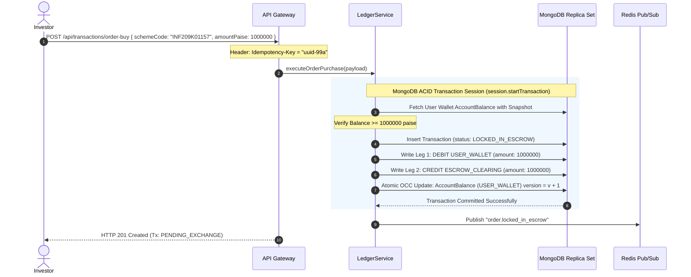
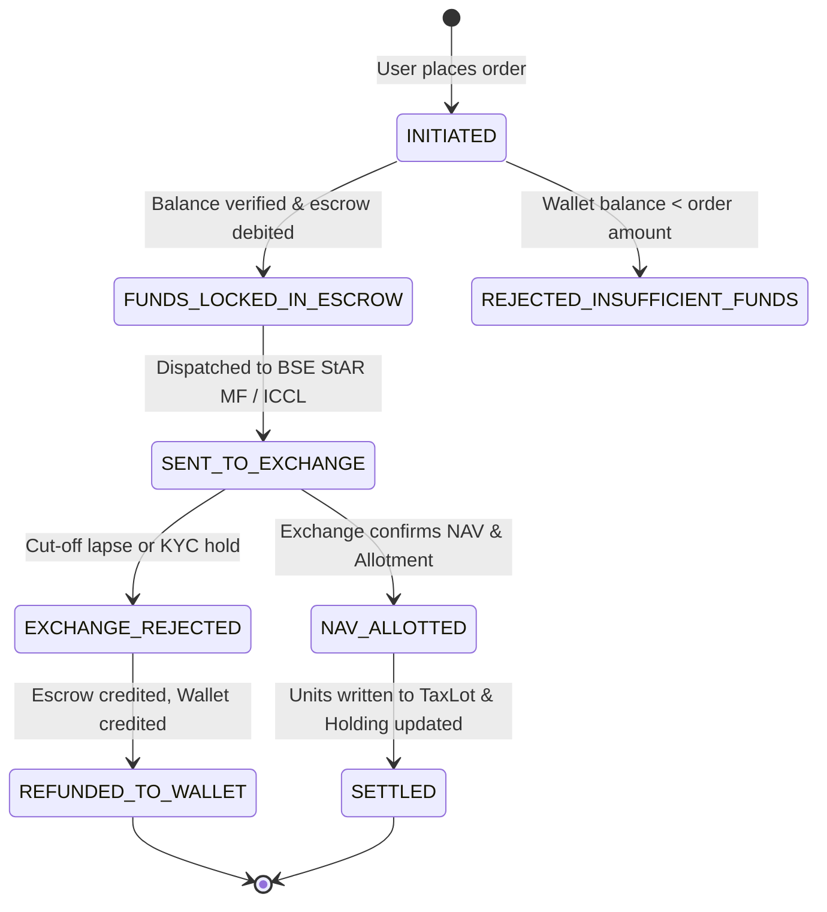
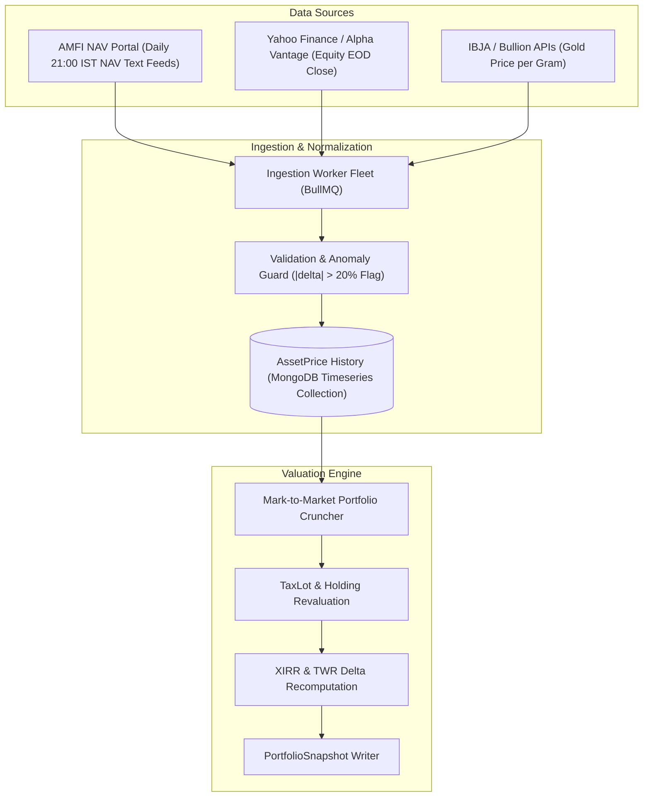

# System Design Document (SDD)
## Institutional Wealth Management & Investment Advisory Platform (IPS v2.0)

**Document Version:** `2.0.0-PROD`  
**Classification:** Institutional Confidential / Internal Engineering Architecture  
**Status:** Approved for Implementation  
**Role:** Principal Distributed Systems Architect  
**Quantitative Architecture Reference:** `docs/PRD.md` & `docs/TRD.md`  
**Target Delivery Window:** Q1–Q3 2027  

---

## 1. Executive System Decomposition & Architecture Overview

The legacy Investment Planner System prototype suffered from foundational architectural anti-patterns:
1.  **Unverified In-Memory Wallet Increments**: Direct modification of `User.walletBalance` without transactional locking, leading to double-spend and reconciliation divergence.
2.  **Monolithic Frontend State Routing**: `UserPortal.jsx` and `AdminPortal.jsx` managed tab views using local React state flags (`activeTab === 'portfolio'`), preventing bookmarking, deep-linking, browser history navigation, and code-splitting.
3.  **Static Hardcoded Asset Pricing**: Fund NAVs and stock prices remained frozen at ingestion time without daily Mark-to-Market (MTM) revaluation.
4.  **Client Polling Floods**: Frontend executed continuous 30-second `setInterval` polling loops against `/api/portfolio` and `/api/user`, generating database connection saturation and stale cache reads.

IPS v2.0 completely replaces these components with a distributed, event-driven, double-entry financial architecture.

```
+----------------------------------------------------------------------------------------------------+
|                                    IPS v2.0 DISTRIBUTED TOPOLOGY                                   |
+----------------------------------------------------------------------------------------------------+
                                      |
                           [ Edge TLS 1.3 Termination ]
                                      |
                                      v
+----------------------------------------------------------------------------------------------------+
|                                       API GATEWAY CLUSTER                                          |
|  * JWT Auth & Dual-Cookie Validation      * Redis Sliding-Window Rate Limiting (120 req/min)       |
|  * Tenant Isolation & IDOR Guards         * Idempotency Interceptor (SETNX Lock)                   |
|  * Real-Time WebSocket Gateway (Socket.io)* RFC 7807 Exception Formatting                          |
+----------------------------------------------------------------------------------------------------+
              |                                            |                        |
       Synchronous CRUD                             Pub/Sub Events          Enqueue Async Jobs
              v                                            v                        v
+-----------------------------+               +----------------------+  +-------------------------+
| PRIMARY REPLICA SET         |               | REDIS 7.2 CLUSTER    |  | BULLMQ WORKER FLEET     |
| [ MongoDB 8.0 Primary Node] |               | * Real-time Pub/Sub  |  | * SIP Recurring Debit   |
| * Multi-Doc ACID Txns       | <============ | * Distributed Locks  |  | * Daily MTM Mark Worker |
| * Secondary Read Pool       | (Oplog Sync)  | * Token Revocation   |  | * Monte Carlo Simulator |
| * WiredTiger Snapshots      |               | * Idempotency Cache  |  | * AMFI/Yahoo Ingest     |
+-----------------------------+               +----------------------+  +-------------------------+
```

---

## 2. Double-Entry Immutable Ledger Engine

### 2.1 The Invariant of Double-Entry Accounting
Under GAAP and institutional financial regulations, money cannot be created or destroyed via a single variable update (`user.walletBalance += amount`). Every financial mutation must be represented as a closed system of balanced debits and credits:

$$\sum \text{Debits} \equiv \sum \text{Credits}$$

In IPS v2.0, account balances are **derived projections** of immutable ledger entries. An account balance is calculated by aggregating its immutable transaction legs:
$$\text{Balance}(A) = \sum_{e \in \text{Credits}(A)} e.\text{amount} - \sum_{e \in \text{Debits}(A)} e.\text{amount}$$

### 2.2 Ledger Chart of Accounts (COA)
IPS v2.0 enforces four primary chart-of-accounts classifications:

```
+----------------------------------------------------------------------------------------------------+
|                                      CHART OF ACCOUNTS (COA)                                       |
+----------------------+--------------------+---------------------+----------------------------------+
| Account Code         | Account Type       | Normal Balance      | Description                      |
+----------------------+--------------------+---------------------+----------------------------------+
| USER_WALLET          | Liability          | Credit              | Client fiat cash available.      |
| ESCROW_CLEARING      | Asset              | Debit               | Funds in-flight to exchange/AMC. |
| ASSET_HOLDING        | Asset              | Debit               | Units/securities owned by user.  |
| FEE_REVENUE          | Revenue            | Credit              | Platform advisory & exit fees.   |
| BANK_SETTLEMENT      | Asset              | Debit               | Physical bank nodal account.     |
+----------------------+--------------------+---------------------+----------------------------------+
```

### 2.3 Ledger Schema Topology

```
+----------------------------------------------------------------------------------------------------+
|                                    LEDGER SCHEMA RELATIONSHIPS                                     |
+----------------------------------------------------------------------------------------------------+
  [ Transaction ] 1 -------- * [ LedgerEntry ] * -------- 1 [ AccountBalance ]
        |                              |                                |
  txId (UUID)                   entryId (UUID)                   accountId (UUID)
  type: BUY/SELL/SIP/DEP        leg: DEBIT / CREDIT              balancePaise: Long
  status: SETTLED               amountPaise: Long                version: Long (__v)
```

#### 2.3.1 MongoDB Schema Specifications

```typescript
import { Schema, Document, Types } from 'mongoose';

// 1. Transaction Header Record
export interface ITransaction extends Document {
  txId: string;
  userId: Types.ObjectId;
  portfolioId?: Types.ObjectId;
  type: 'DEPOSIT' | 'WITHDRAWAL' | 'ORDER_BUY' | 'ORDER_SELL' | 'SIP_INSTALLMENT' | 'FEE_ASSESSMENT';
  status: 'PENDING' | 'LOCKED_IN_ESCROW' | 'SETTLED' | 'REJECTED' | 'REVERSED';
  currency: string;
  totalAmountPaise: Types.Long;
  idempotencyKey: string;
  narration: string;
  metadata: Record<string, unknown>;
  createdAt: Date;
  updatedAt: Date;
}

export const TransactionSchema = new Schema<ITransaction>({
  txId: { type: String, required: true, unique: true, index: true },
  userId: { type: Schema.Types.ObjectId, ref: 'User', required: true, index: true },
  portfolioId: { type: Schema.Types.ObjectId, ref: 'Portfolio', index: true },
  type: { 
    type: String, 
    enum: ['DEPOSIT', 'WITHDRAWAL', 'ORDER_BUY', 'ORDER_SELL', 'SIP_INSTALLMENT', 'FEE_ASSESSMENT'], 
    required: true,
    index: true 
  },
  status: { 
    type: String, 
    enum: ['PENDING', 'LOCKED_IN_ESCROW', 'SETTLED', 'REJECTED', 'REVERSED'], 
    default: 'PENDING',
    index: true 
  },
  currency: { type: String, default: 'INR' },
  totalAmountPaise: { type: Schema.Types.Long, required: true },
  idempotencyKey: { type: String, required: true, unique: true, index: true },
  narration: { type: String, required: true },
  metadata: { type: Schema.Types.Mixed, default: {} }
}, { timestamps: true });

// 2. Immutable Ledger Entry (The Balanced Legs)
export interface ILedgerEntry extends Document {
  entryId: string;
  txId: string;
  accountType: 'USER_WALLET' | 'ESCROW_CLEARING' | 'ASSET_HOLDING' | 'FEE_REVENUE' | 'BANK_SETTLEMENT';
  accountReferenceId: string; // e.g., userId, schemeCode, or platformAccountId
  direction: 'DEBIT' | 'CREDIT';
  amountPaise: Types.Long;
  runningBalancePaise: Types.Long;
  recordedAt: Date;
}

export const LedgerEntrySchema = new Schema<ILedgerEntry>({
  entryId: { type: String, required: true, unique: true, index: true },
  txId: { type: String, required: true, index: true },
  accountType: { 
    type: String, 
    enum: ['USER_WALLET', 'ESCROW_CLEARING', 'ASSET_HOLDING', 'FEE_REVENUE', 'BANK_SETTLEMENT'], 
    required: true,
    index: true 
  },
  accountReferenceId: { type: String, required: true, index: true },
  direction: { type: String, enum: ['DEBIT', 'CREDIT'], required: true },
  amountPaise: { type: Schema.Types.Long, required: true },
  runningBalancePaise: { type: Schema.Types.Long, required: true },
  recordedAt: { type: Date, default: Date.now, index: true }
}, { timestamps: false, versionKey: false });

// 3. Fast Cached Balance Projection with Optimistic Concurrency Control
export interface IAccountBalance extends Document {
  accountId: string; // Composite key: accountType:accountReferenceId
  accountType: string;
  accountReferenceId: string;
  balancePaise: Types.Long;
  version: number; // Optimistic locking
  lastTxId: string;
  updatedAt: Date;
}

export const AccountBalanceSchema = new Schema<IAccountBalance>({
  accountId: { type: String, required: true, unique: true, index: true },
  accountType: { type: String, required: true },
  accountReferenceId: { type: String, required: true },
  balancePaise: { type: Schema.Types.Long, required: true, default: 0 },
  version: { type: Number, required: true, default: 0 },
  lastTxId: { type: String, required: true }
}, { timestamps: true });
```

### 2.4 Transactional Execution Engine & Balanced Ledger Walkthrough
Below is the atomic execution flow for an Mutual Fund Buy Order of ₹10,000 (1,000,000 paise):



#### Verification Rules Enforced by the Engine
1.  **Zero-Sum Invariant Check**:
    $$\sum \text{Amount}_{\text{DEBIT}} - \sum \text{Amount}_{\text{CREDIT}} == 0$$
    If delta $\neq 0$, the database transaction is immediately aborted.
2.  **Optimistic Concurrency Control (OCC)**:
    When updating `AccountBalance`, the query condition enforces:
    `{ accountId: targetId, version: currentVersion }`.
    If another thread modified the balance concurrently, `matchedCount === 0`, throwing a `ConcurrentLedgerMutationError` that triggers an automatic exponential backoff retry.

---

## 3. Order Execution & SIP Mandate State Machine

### 3.1 Order Lifecycle State Machine



### 3.2 State Transition Matrix & Invariants

| From State | To State | Trigger Event | Invariant / Ledger Action | Reversible? |
|---|---|---|---|---|
| `INITIATED` | `FUNDS_LOCKED` | Validation success | DEBIT `USER_WALLET`, CREDIT `ESCROW_CLEARING` | No |
| `INITIATED` | `REJECTED` | Balance check fail | Zero ledger mutations | Yes (Terminal) |
| `FUNDS_LOCKED` | `SENT_TO_EXCHANGE` | API dispatch to AMC | Order batch signed with RSA-256 | No |
| `SENT_TO_EXCHANGE` | `NAV_ALLOTTED` | RTA allotment file | Exact NAV and units received from RTA | No |
| `NAV_ALLOTTED` | `SETTLED` | Unit clearance | DEBIT `ESCROW_CLEARING`, CREDIT `ASSET_HOLDING`. Create `TaxLot`. | No (Terminal) |
| `SENT_TO_EXCHANGE` | `REFUNDED` | Exchange reject | DEBIT `ESCROW_CLEARING`, CREDIT `USER_WALLET` | No (Terminal) |

---

### 3.3 Automated SIP Execution Scheduler (BullMQ + Redis)
To replace fragile in-process timers, SIP execution is managed via a distributed **BullMQ** delayed-job pipeline.

```
+----------------------------------------------------------------------------------------------------+
|                                    BULLMQ SIP EXECUTION ENGINE                                     |
+----------------------------------------------------------------------------------------------------+
  [ Cron Dispatcher Worker ] (Triggers Daily at 04:00 AM IST)
              |
              | 1. Query SIPMandates where nextExecutionDate <= Today && status == 'ACTIVE'
              v
  [ BullMQ Queue: "sip-execution-queue" ]
              |
              +---> [ Job 1: Mandate #M-101 ] --> [ Worker Node A ]
              +---> [ Job 2: Mandate #M-102 ] --> [ Worker Node B ]
              +---> [ Job 3: Mandate #M-103 ] --> [ Worker Node C ]
```

#### 3.3.1 Step-Up Mandate Escalation Logic
Every execution checks whether the mandate has reached its annual step-up boundary:
```typescript
export async function evaluateStepUp(mandate: ISIPMandate): Promise<number> {
  let executionAmount = mandate.currentAmountPaise;

  if (mandate.stepUpConfig && mandate.stepUpConfig.nextStepUpDate <= new Date()) {
    if (mandate.stepUpConfig.stepUpType === 'PERCENTAGE') {
      // Escalation = current * (1 + pct / 100)
      const multiplier = 1 + (mandate.stepUpConfig.stepUpValue / 100);
      executionAmount = Math.round(Number(mandate.currentAmountPaise) * multiplier);
    } else {
      // Escalation = current + fixedAmountPaise
      executionAmount = Number(mandate.currentAmountPaise) + mandate.stepUpConfig.stepUpValue;
    }

    // Guardrail against mandate ceiling
    if (executionAmount > Number(mandate.mandateMaxLimitPaise)) {
      executionAmount = Number(mandate.mandateMaxLimitPaise);
    }

    // Persist updated mandate installment
    mandate.currentAmountPaise = executionAmount as any;
    mandate.stepUpConfig.lastStepUpDate = new Date();
    // Schedule next annual escalation (12 months out)
    mandate.stepUpConfig.nextStepUpDate = new Date(Date.now() + 365 * 24 * 60 * 60 * 1000);
    await mandate.save();
  }

  return executionAmount;
}
```

#### 3.3.2 Insufficient Balance & Dunning Backoff Schedule
If the user wallet lacks sufficient funds on the execution date:
1.  **Failure 1 ($T+0$)**: Record `consecutiveFailures = 1`. Enqueue retry in BullMQ with 48-hour delay (`delay: 172800000`). Send email & push alert to investor.
2.  **Failure 2 ($T+2$)**: Record `consecutiveFailures = 2`. Enqueue final retry in BullMQ with 48-hour delay.
3.  **Failure 3 ($T+4$)**: Record `consecutiveFailures = 3`. Transition `SIPMandate.status` to `AUTO_PAUSED`. Release mandate locks and notify user to manually top up and unpause.

---

## 4. Market Data Ingestion & Daily Mark-to-Market (MTM) Pipeline



### 4.1 Upstream Feeds & Ingestion Schedule
1.  **Mutual Funds (AMFI)**:
    *   Ingests official NAV text file (`https://www.amfiindia.com/spages/NAVAll.txt`) at 21:30 IST daily.
    *   Parses Scheme Code, ISIN, Scheme Name, Net Asset Value, and Date.
2.  **Equities (Yahoo Finance / NSE)**:
    *   Ingests equity close prices at 16:30 IST post-market close.
3.  **Sovereign Gold & Physical Bullion**:
    *   Ingests India Bullion and Jewellers Association (IBJA) closing rate at 17:00 IST.

### 4.2 Anomaly Detection & Circuit Breaker Guard
Upstream feed corruption (e.g., an AMFI typo listing NAV as ₹1,200 instead of ₹120.0) is intercepted prior to ledger application:
$$\text{PriceDeviation} = \frac{|\text{Price}_{\text{new}} - \text{Price}_{\text{prev}}|}{\text{Price}_{\text{prev}}}$$
If $\text{PriceDeviation} > 0.20$ ($20\%$ swing in 24 hours):
*   Asset is flagged as `PRICE_ANOMALY_HALTED`.
*   Automatic MTM revaluation for this asset is paused.
*   A Maker-Checker inspection proposal is immediately dispatched to compliance.

### 4.3 Daily PortfolioSnapshot Timeseries Document
To render sub-second portfolio historical charts on the frontend, IPS v2.0 never aggregates raw transaction history on read queries. Instead, the MTM worker materializes a daily `PortfolioSnapshot`:

```typescript
export interface IPortfolioSnapshot extends Document {
  portfolioId: Types.ObjectId;
  userId: Types.ObjectId;
  date: Date; // Normalized to 00:00:00.000Z
  totalInvestedPaise: Types.Long;
  currentValuePaise: Types.Long;
  unrealizedGainPaise: Types.Long;
  realizedGainPaise: Types.Long;
  xirr: Types.Decimal128;
  twr: Types.Decimal128;
  assetAllocation: {
    equityPaise: Types.Long;
    debtPaise: Types.Long;
    goldPaise: Types.Long;
    cashPaise: Types.Long;
  };
}
```

*   **Query Optimization**: MongoDB time-series collection or standard collection indexed on `{ portfolioId: 1, date: -1 }`.
*   **Performance**: Chart queries fetch 365 pre-calculated points in $< 15\text{ ms}$.

---

## 5. Real-Time Event Gateway & Notification Bus

### 5.1 Eradication of Client Polling
The prototype's 30-second frontend polling loop (`setInterval(fetchPortfolio, 30000)`) is decommissioned. It is replaced with a **Socket.io / Server-Sent Events (SSE)** gateway backed by **Redis Pub/Sub**.

```
+----------------------------------------------------------------------------------------------------+
|                                REAL-TIME EVENT FAN-OUT TOPOLOGY                                    |
+----------------------------------------------------------------------------------------------------+
  [ Backend Worker / Service ]
              |
              | 1. redisClient.publish("user.events:<userId>", JSON.stringify(event))
              v
  [ Redis Cluster Pub/Sub Channel ]
              |
       +------+-----------------------------+
       |                                    |
       v                                    v
  [ API Gateway Pod 1 ]               [ API Gateway Pod 2 ]
  (Holds WS Connection for User A)    (Holds WS Connection for User B)
       |                                    |
       | emit("portfolio.updated")          | emit("order.settled")
       v                                    v
  [ Client Browser A ]                [ Client Browser B ]
```

### 5.2 Real-Time Event Schema Specification
All gateway events implement the standard envelope:

```typescript
export interface RealtimeEvent<T = unknown> {
  eventId: string;
  eventType: 
    | 'TRANSACTION_SETTLED'
    | 'NAV_UPDATED'
    | 'SIP_EXECUTED'
    | 'SIP_FAILED_DUNNING'
    | 'MAKER_CHECKER_REQUEST'
    | 'GOAL_DRIFT_WARNING';
  userId: string;
  timestamp: string; // ISO 8601
  payload: T;
}
```

#### Event Payloads
1.  **`TRANSACTION_SETTLED`**:
    Dispatched when BSE StAR MF/ICCL confirms unit allotment. Frontend queries TanStack Query cache invalidator `queryClient.invalidateQueries(['portfolio'])`.
2.  **`GOAL_DRIFT_WARNING`**:
    Dispatched when MTM worker determines equity allocation drifted $> 5\%$ from target profile. Renders toast notification with direct link to rebalancer.
3.  **`MAKER_CHECKER_REQUEST`**:
    Dispatched instantly to all active compliance sessions when a new proposal is submitted.

---

*End of System Design Document (SYSTEM_DESIGN.md)*

